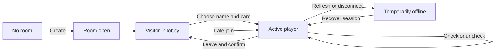

# 02 — User flows and state transitions

## Pages and routes (proposed)

| Route | View | Notes |
| --- | --- | --- |
| `/` | Landing/create room | Minimal: title, **Raum erstellen**; may redirect to last room as optional enhancement. |
| `/r/:roomCode` | Room lobby | Participants, live progress, name/card chooser, room invite link. |
| `/r/:roomCode/play` | Personal bingo | Requires own active player session; otherwise navigate to the lobby. |
| unknown room | Error page | **Raum nicht gefunden** / friendly recovery. |

Navigation is client-side; server exposes API separately under `/api/`.

## Flow A — Create and share

1. Visit homepage and select **Raum erstellen**.
2. Server generates a random room code, initializes one room Durable Object and returns a lobby URL.
3. Browser opens lobby. User can copy **Einladungslink kopieren**.
4. Share URL in Discord; no login or installation.

**Acceptance:** opening the invitation in a different browser shows the same empty or active lobby.

## Flow B — Join, even when others are already playing

1. Visitor opens existing lobby URL; current public players and progress load.
2. Enter a name, select **Karte 1–10** (optionally inspect a preview).
3. Click **Bingo starten**. Server checks room existence, available name and card validity.
4. Server generates a random, room-scoped session token; stores only a token hash; sends a secure HttpOnly cookie.
5. Player navigates to `/play`; other participants see the new player appear without interruption.

**Duplicate cards:** allowed. **Duplicate names:** reject with **Dieser Name ist bereits vergeben.**

## Flow C — Mark / undo an event

1. Click an ordinary cell; visually checked state toggles immediately.
2. Client sends desired final boolean state (not a `toggle` operation) to own authenticated endpoint.
3. Server validates participant, square index 0–24 and immutable free center.
4. Server persists the changed 25-bit checked mask, recomputes progress/bingos, increments room revision, and broadcasts updated public state.
5. Client reconciles with server response. If rejected or disconnected, show a pending/error indicator and resync.

**Idempotency:** repeating `checked: true` must not toggle it off. A second intentional click to `false` unchecks it. See [API](06-api-realtime.md).

## Flow D — Compare without leaving current game

1. Click **Vergleich**.
2. Sidebar opens, listing names, selected card IDs, `n/25`, bingo lines, and optionally online status.
3. Select a participant to view a **read-only** 5×5 board (their selected objectives, their marks, and completed lines).
4. Close panel and continue at exactly the same own board state.

Lobby progress should use the same authoritative data model as the sidebar.

## Flow E — Reconnect / refresh

1. Player refreshes or temporarily goes offline.
2. Existing room-scoped cookie identifies active participant when network is restored.
3. GET `/api/rooms/:roomCode/me` resolves player. Client downloads canonical snapshot and reopens the personal board.
4. Client resumes WebSocket subscription; missed events are replaced by a fresh snapshot.

No logout or card reset occurs. Closing a tab merely makes the participant eventually appear offline.

If cookies were manually deleted or browser storage was wiped, automatic recovery is not guaranteed. A recovery-code feature is deferred.

## Flow F — Intentional leave (destructive)

1. Select **Verlassen** from the bingo screen.
2. Show confirmation: **Wirklich verlassen? Deine Bingokarte und dein Fortschritt werden gelöscht.** Buttons **Abbrechen** and **Verlassen und löschen**.
3. On confirmation, call authenticated leave endpoint.
4. Server deletes/revokes only that participant's active record, updates the lobby and invalidates the cookie.
5. Navigate to lobby to choose name/card again. Others continue uninterrupted.

Cancelling or merely navigating/refreshing must never delete progress. Failure during leave must not pretend the deletion succeeded; retry or report the error.

## Room and player lifecycle

A room is **open** even after one participant wins. The first server-recorded bingo is tracked for display, not used to prevent new joins.
