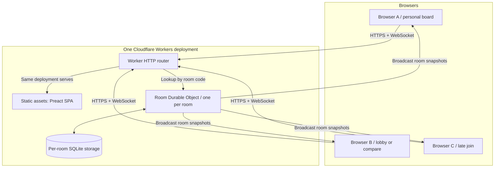
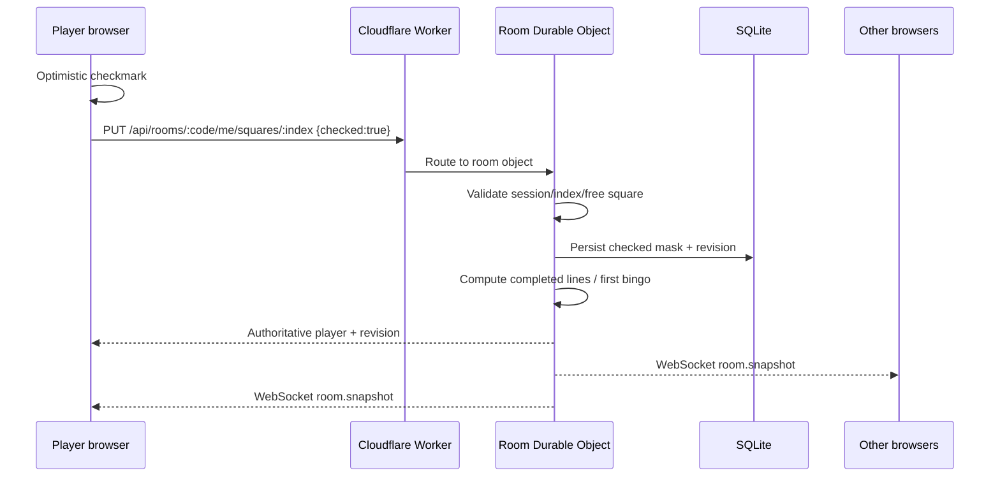

# 04 — Architecture

**Chosen direction:** Preact/TypeScript SPA + Cloudflare Worker + one SQLite-backed Durable Object per room + WebSocket Hibernation. ADR: [0001](adr/0001-cloudflare-durable-objects.md).

## Component topology



Graph is conceptual; actual WebSocket upgrades pass through the Worker router to the Durable Object. All browser traffic is same-origin.

## Responsibilities

**Frontend (`src/client/`, proposed)**

- Route the landing, lobby, and bingo screens.
- Render immutable card objectives from the authoritative room/player response.
- Hold provisional optimistic UI for a pending square click and reconcile with server responses.
- Connect to server room events; display the latest snapshot/revision.
- Keep room state distinct from the player's private session/own board.
- Provide accessible dialogs, comparison panel and reconnect indicators.

**HTTP Worker (`src/worker/`, proposed)**

- Serve compiled SPA assets (via Cloudflare Vite integration).
- Route `/api/` endpoints and WebSocket upgrades to the room Durable Object.
- Validate room code format, request method/content type/body size, and Origin on mutating operations.
- Return safe JSON error payloads without leaking tokens or stack traces.
- No global in-memory lobby map; Workers instances are stateless.

**Room Durable Object (`src/worker/room.ts`, proposed)**

- Serialized authority for one room's joins, exits, square updates and first-winner selection.
- Read/write persistent SQLite, validate session cookie against stored token hash.
- Compute derived progress and bingo lines.
- Hold hibernatable WebSockets and publish updated read-only room snapshots.
- Maintain a monotonic `revision` incremented for each state-changing operation.
- Support reinitialization after hibernation without relying on in-memory state.

**Shared packages/helpers (`src/shared/`, proposed)**

- Card types, DTOs, message schemas, card validation and **pure bingo-line calculator**.
- Shared parsing/schema validation (a small validation library is optional; minimize dependency count).

## Proposed repository structure (later code milestones)

```text
README.md
AGENTS.md
PROJECT_STATUS.md
data/cards.json                   # canonical preset content
/docs/...                         # specifications, source, decisions
/src/client/                      # Preact routes/components/style
/src/worker/                      # Worker entry + Room Durable Object
/src/shared/                      # Types, validators, pure bingo rules
/tests/unit/
/tests/integration/
/tests/e2e/
/public/
index.html
vite.config.ts
wrangler.jsonc
package.json
```

**Not yet present:** `src/`, tests, package configuration. This layout is a target, not a claim about current files.

## Important design choices

**A. One Durable Object per room.** All operations on a room reach the same logical authority. No cross-room coordination or centralized room index needed for MVP.

**B. Persist game state, not only WebSocket connections.** Durable Objects may hibernate/restart, so authoritative marks, sessions and winner state must live in SQLite.

**C. Server-authoritative game logic.** Clients render optimistically but cannot submit arbitrary total progress or bingo counts. Server calculates these from marks and immutable objectives.

**D. Room snapshots are adequate for small private lobbies.** Upon join and every changed square, broadcast a public snapshot with revision, players, progress and boards. At MVP scale this is simpler and safer than diff/event-stream replay. If performance later demands, add incremental events with resync semantics.

**E. Immutable card snapshot on join.** A player record stores card ID/version plus a copy of its 25 labels. A deployment changing the static card catalog must not silently change an existing active board.

**F. Same-origin.** No CORS reliance, no Firebase or Supabase credentials, no third-party user login.

## Message flow for a click



## Source references / revalidation

- Workers static assets: https://developers.cloudflare.com/workers/static-assets/
- Cloudflare Vite integration: https://developers.cloudflare.com/workers/vite-plugin/
- Durable Objects overview: https://developers.cloudflare.com/durable-objects/
- WebSocket Hibernation API: https://developers.cloudflare.com/durable-objects/best-practices/websockets/
- SQLite storage best practices: https://developers.cloudflare.com/durable-objects/best-practices/access-durable-objects-storage/

Checked **2026-10-25**. Exact plugin and Wrangler configuration syntax must be confirmed against installed versions when implementing.
